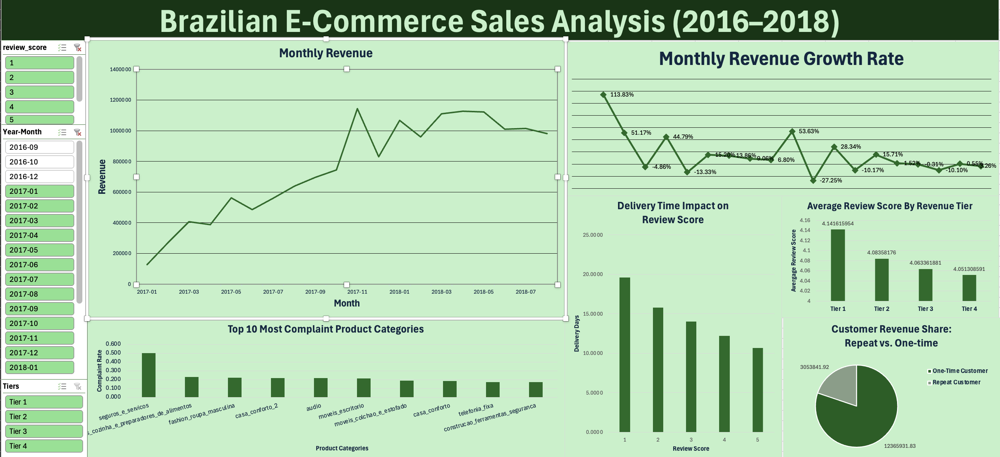

# Brazilian E-Commerce Analysis (Olist, 2016–2018)

Analysis of sales data from Olist, a Brazilian e-commerce marketplace, using SQL and Excel to understand revenue growth and customer satisfaction.

## Questions

1. How did monthly revenue grow, and is it still growing?
2. Do high-revenue sellers get better reviews?
3. Does delivery time affect review score?
4. How much revenue comes from repeat customers?
5. Which product categories get the most complaints?

## Tools
MySQL (cleaning + analysis), Excel (dashboard)

## Data
Olist dataset on Kaggle: https://www.kaggle.com/datasets/olistbr/brazilian-ecommerce

## Status
Work in progress — findings write-up coming.
